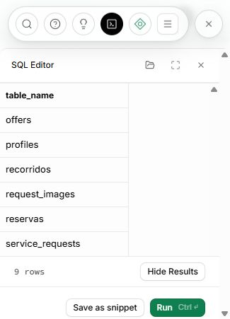

# ArreglaYa

Aplicación Flutter que conecta clientes que necesitan una reparación con técnicos que pueden enviar ofertas.

## Equipo y actividad

Actividad 02, Aplicaciones Móviles I, Universidad Privada Domingo Savio.

- Fernando Adriel Montero Casanova
- María Lizeth Marcelo Claros

Docente indicado: Liber. Fecha del taller: 13/11/2026.

Repositorio: [fernando-420/arreglaya](https://github.com/fernando-420/arreglaya).

ArreglaYa busca facilitar el contacto entre personas que necesitan reparaciones y técnicos independientes. El proyecto se relaciona con el ODS 8 por su propósito de apoyar oportunidades de trabajo. Todavía no se han medido resultados económicos o de empleo.

El taller original utiliza ConectaCruz, un catálogo de negocios con consultas y reservas. En este proyecto, las solicitudes y las ofertas representan la consulta y la contratación de reparaciones. FlutterFlow no se utilizó. Estas equivalencias deben ser aceptadas por el docente y no demuestran el cumplimiento literal de todos los requisitos del ejemplo.

## Evidencias y estado



Se comprobó mediante SQL el registro, la verificación, la aceptación de una oferta y los permisos. Los datos temporales se revirtieron al terminar. La prueba de la pantalla de configuración pasó y se compiló el APK Android de demostración.

Pendiente: capturas del flujo completo en un teléfono, informe PDF y video de los integrantes. Las notificaciones push todavía requieren el registro de dispositivos y el servicio de envío. No hay pagos integrados. Debe mejorarse la privacidad de las coordenadas exactas y la visibilidad de los teléfonos.

El cuaderno editable adaptado se encuentra en `entregables/Actividad_02_ArreglaYa_Supabase.pptx`.

## Proyecto conectado

### Confirmación del correo en Android e iOS

La app solicita que los nuevos correos regresen a `io.arreglaya.app://login-callback`. Android e iOS registran ese enlace; Supabase Flutter recibe la sesión con `app_links`, sin el manejador de rutas de Flutter.

**Configuración pendiente en el panel:** en Authentication → URL Configuration del proyecto `hjmckadneaynnnrrtith`, agregar exactamente `io.arreglaya.app://login-callback` a **Redirect URLs** y guardar. Conservar las otras direcciones y el Site URL del proyecto compartido. Si no se autoriza el enlace, Supabase puede volver al Site URL (actualmente el teléfono muestra `localhost`). Mantener activa la confirmación del correo.

Instalar la APK actualizada antes de abrir un nuevo correo. Los correos anteriores conservan su enlace original. Si un enlace anterior ya confirmó la cuenta antes de fallar al abrir localhost, volver a la app e ingresar con el correo y la contraseña. Para probar el regreso automático hace falta un correo nuevo enviado desde la versión actualizada, con la dirección autorizada en el panel, y abrirlo en el mismo teléfono. Este recorrido todavía requiere comprobación en un dispositivo real; la compilación por sí sola no lo verifica.

El inicio de sesión permite dos errores de correo o contraseña sin espera. Al tercer error consecutivo, deshabilita el botón durante 30 segundos con una cuenta regresiva. Un ingreso correcto o el fin de la espera reinicia el contador. Esta pausa es local a la pantalla; no sustituye los límites de Supabase y se reinicia al cerrar la app. Los errores de conexión y el límite de correos de confirmación no cuentan como contraseñas incorrectas. Las pruebas de interfaz comprueban los tres intentos y la recuperación después de la espera.

La app utiliza por defecto el proyecto `hjmckadneaynnnrrtith` de la organización `ruta-chiquitana`. Su URL y clave pública están configuradas en `lib/main.dart`; se pueden reemplazar mediante `--dart-define`. La clave pública identifica el proyecto y no concede permisos de administrador.

Ejecuta `flutter run` para utilizar esta conexión. La base se instaló el 13 de noviembre de 2026 con `supabase/install_new_project.sql`, que ya incluye el esquema, las ampliaciones, los permisos, la aceptación de ofertas y Realtime. No vuelvas a ejecutar el esquema ni las migraciones sobre este proyecto: ya están aplicados.

Se conservaron las tablas `recorridos` y `reservas`. El registro de ArreglaYa envía la marca `app: arreglaya`; solo esas cuentas generan un perfil de esta app. Las cuentas de la base anterior no se migraron: los usuarios deben registrarse de nuevo en este proyecto. No se asignó ningún administrador automáticamente.

`supabase/verify_installation.sql` comprueba registro, verificación, aceptación y permisos con datos temporales dentro de una transacción que se revierte al terminar. No deja cuentas ni solicitudes de prueba guardadas.

## Configurar otro proyecto de Supabase

1. Crea un proyecto en [Supabase](https://supabase.com/dashboard).
2. Abre **SQL Editor** y ejecuta todo el archivo [`supabase/schema.sql`](supabase/schema.sql).
3. En **Authentication > Providers > Email**, para una demostración rápida puedes desactivar **Confirm email**. Para producción debe mantenerse activo.
4. En **Project Settings > API**, copia la **Project URL** y la clave pública **Publishable** (o `anon` si tu panel aún la muestra). Nunca uses `service_role` en la aplicación.

## Ejecutar en el teléfono conectado

```powershell
flutter run --dart-define=SUPABASE_URL=https://TU-PROYECTO.supabase.co --dart-define=SUPABASE_ANON_KEY=TU_CLAVE_PUBLICA
```

## Crear APK de demostración

```powershell
flutter build apk --debug --dart-define=SUPABASE_URL=https://TU-PROYECTO.supabase.co --dart-define=SUPABASE_ANON_KEY=TU_CLAVE_PUBLICA
```

El APK se genera en `build/app/outputs/flutter-apk/app-debug.apk`.

## Actualización de seguridad y aceptación de ofertas

Antes de instalar esta versión sobre un proyecto existente:

1. Comprueba que estén aplicados `schema.sql` y los archivos de `supabase/migrations` en orden, del 002 al 010. El esquema inicial por sí solo no contiene todas las funciones de la app.
2. Ejecuta `supabase/security_upgrade.sql` completo en el SQL Editor. Protege el rol y la verificación de los perfiles y añade las funciones `accept_offer` y `verify_technician` que usa esta versión.
3. Distribuye la nueva app después de aplicar el SQL. Las versiones anteriores ya no podrán aceptar ofertas ni verificar técnicos mediante actualizaciones directas.

La aceptación comprueba al dueño de la solicitud y la verificación del técnico, bloquea la solicitud durante la operación, acepta una sola oferta y rechaza las demás en la misma transacción. Un índice impide guardar dos ofertas aceptadas para la misma solicitud.

Si ya existen solicitudes con varias ofertas aceptadas, el script se detendrá sin aplicar cambios. Revísalas y resuelve qué oferta corresponde antes de volver a ejecutarlo:

```sql
select request_id, array_agg(id order by id) as accepted_offer_ids
from public.offers
where status = 'aceptada'
group by request_id
having count(*) > 1;
```

Comprueba con cuentas de prueba que un cliente no pueda cambiar su rol o su verificación, que solo el administrador pueda verificar técnicos y que dos clientes de la app intentando aceptar ofertas distintas de una solicitud dejen una sola oferta aceptada. Comprueba también que el dueño pueda editar sus datos de contacto.

Las notificaciones push siguen pendientes: la inicialización de Firebase no incluye registro de dispositivos ni un servicio de envío. No se han activado avisos automáticos con esta actualización.
